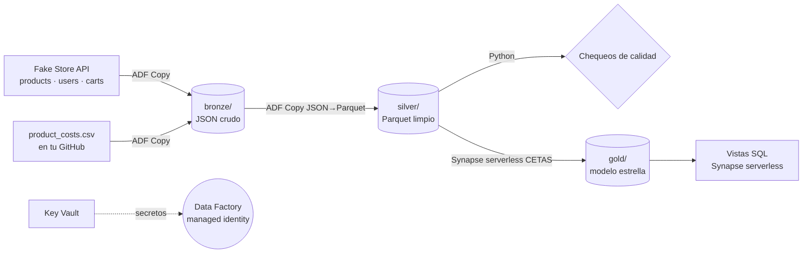

# Guía paso a paso · P1 Retail Sales Lakehouse en Azure

Esta guía la sigues **tú**, paso por paso. Escribe cada comando y cada línea de código, no los copies y pegues: así es como se repasa. Al terminar cada paso:

1. Revisa la sección **"Comprueba"**.
2. Marca el paso en `PROGRESS.md` y en el tracker (pestaña Repaso CV → P1).
3. Responde en voz alta, en inglés, la **pregunta de entrevista**.
4. Haz un commit con lo que hayas creado.

Si algo falla o no lo entiendes, abre Claude Code en esta carpeta y pregunta. Te explico, pero no lo hago por ti.

> **Reglas de oro**
> - Usa **tu cuenta personal de Azure**. Nunca la de Rubikapp ni la de otro empleador.
> - Usa **solo datos públicos**. Nada de código, datos ni nombres de tu trabajo.
> - **Cuida los costos.** Crea la alerta de presupuesto antes que cualquier otro recurso, no uses Mapping Data Flows (encienden clústeres Spark que cobran), usa solo el SQL **serverless** de Synapse y borra todo al final (paso 7).
> - Los comandos de Azure CLI cambian con el tiempo. Si uno falla, busca el nombre del comando en la documentación oficial (learn.microsoft.com) antes de inventar parámetros.

---

## Arquitectura que vas a construir



Nombres que usará la guía (cámbialos si quieres, pero sé consistente):

| Recurso | Nombre de ejemplo |
|---|---|
| Resource group | `rg-retail-lakehouse` |
| Región | `eastus2` |
| Storage account (ADLS Gen2) | `stretaillake<tus iniciales><número>` (único en todo Azure, solo minúsculas y números, de 3 a 24 caracteres) |
| Key Vault | `kv-retail-<iniciales><número>` |
| Data Factory | `adf-retail-<iniciales><número>` |
| Synapse workspace | `syn-retail-<iniciales><número>` |

---

## Paso 0 · Preparación

### 0.1 Repositorio en GitHub
```bash
cd C:/Users/alejo/Projects/study/p1-retail-lakehouse
git init
git config user.name "Hernan Osorio"
git config user.email "143466564+hernanoso@users.noreply.github.com"
git add .
git commit -m "chore: project skeleton"
gh repo create hernanoso/p1-retail-lakehouse --public --source . --push
git branch --show-current      # anota el nombre de tu rama (main o master); lo usarás en el paso 3
```

### 0.2 Cuenta personal de Azure
1. Entra a https://azure.microsoft.com/free con una **cuenta Microsoft personal**, no la del trabajo.
2. Lee las condiciones vigentes de la cuenta gratuita en esa página (créditos y servicios gratis). No asumas montos.

### 0.3 Alerta de presupuesto (antes que todo lo demás)
En el portal: **Cost Management → Budgets → + Add**. Monto: USD 5 al mes. Alertas al 50 %, 80 % y 100 % enviadas a tu correo.

### 0.4 Azure CLI y resource group
1. Instala Azure CLI: https://learn.microsoft.com/cli/azure/install-azure-cli
2. Corre:
```bash
az login
az account show --output table          # confirma que es TU suscripción personal
az group create --name rg-retail-lakehouse --location eastus2
```

**Comprueba:**
- `git log` muestra al autor Hernan Osorio.
- El repo se ve en GitHub.
- La alerta aparece en Budgets.
- `az group list -o table` muestra el resource group.

**Pregunta de entrevista:** *"How do you keep cloud costs under control in a personal or dev environment?"*

---

## Paso 1 · ADLS Gen2 con capas medallion

```bash
az storage account create \
  --name <storage> --resource-group rg-retail-lakehouse --location eastus2 \
  --sku Standard_LRS --kind StorageV2 --hns true --min-tls-version TLS1_2 \
  --allow-blob-public-access false

# Date permiso de datos a ti mismo (necesario para --auth-mode login)
az role assignment create --assignee $(az ad signed-in-user show --query id -o tsv) \
  --role "Storage Blob Data Contributor" \
  --scope $(az storage account show -n <storage> -g rg-retail-lakehouse --query id -o tsv)

# Los permisos tardan unos minutos en aplicarse
for c in bronze silver gold; do
  az storage fs create --name $c --account-name <storage> --auth-mode login
done
```

Entiende lo que haces:
- `--hns true` activa el *hierarchical namespace*. Eso es lo que convierte un Blob Storage en **Data Lake Gen2**, con carpetas reales y ACLs.
- Te asignas un rol de **datos** (Storage Blob Data Contributor). Ser Owner de la cuenta no basta para leer y escribir datos con Entra ID.

**Comprueba:** `az storage fs list --account-name <storage> --auth-mode login -o table` muestra los 3 contenedores.

**Pregunta de entrevista:** *"What's the difference between Blob Storage and ADLS Gen2, and why bronze/silver/gold?"*

---

## Paso 2 · Key Vault, Data Factory y managed identity

### 2.1 Key Vault
```bash
az keyvault create --name <keyvault> --resource-group rg-retail-lakehouse \
  --location eastus2 --enable-rbac-authorization true

# Para poder crear secretos tú mismo
az role assignment create --assignee $(az ad signed-in-user show --query id -o tsv) \
  --role "Key Vault Secrets Officer" \
  --scope $(az keyvault show -n <keyvault> --query id -o tsv)

# Un secreto de práctica: la URL base del API (en un proyecto real sería una API key)
az keyvault secret set --vault-name <keyvault> --name fakestore-base-url --value "https://fakestoreapi.com/"
```

### 2.2 Data Factory (desde el portal)
Portal → **Create a resource → Data Factory**. Usa el resource group, la región `eastus2`, el nombre `<adf>` y la versión V2. En la pestaña *Git configuration* marca **"Configure Git later"**.

Al crearla, Azure le da una **system-assigned managed identity**. Compruébalo:
```bash
az resource show -g rg-retail-lakehouse -n <adf> \
  --resource-type Microsoft.DataFactory/factories --query identity.principalId -o tsv
```
Guarda ese `principalId`.

### 2.3 Permisos para la identidad de ADF (RBAC)
```bash
ADF_ID=<principalId>
az role assignment create --assignee-object-id $ADF_ID --assignee-principal-type ServicePrincipal \
  --role "Storage Blob Data Contributor" \
  --scope $(az storage account show -n <storage> -g rg-retail-lakehouse --query id -o tsv)

az role assignment create --assignee-object-id $ADF_ID --assignee-principal-type ServicePrincipal \
  --role "Key Vault Secrets User" \
  --scope $(az keyvault show -n <keyvault> --query id -o tsv)
```

**Comprueba:** `az role assignment list --assignee $ADF_ID --all -o table` muestra los 2 roles.

**Pregunta de entrevista:** *"Why use a managed identity instead of a connection string or account key?"*

---

## Paso 3 · Ingesta a Bronze con un pipeline parametrizado

### 3.1 El CSV de costos (archivo propio, datos inventados por ti)
Crea `seed/product_costs.csv` con este encabezado y unas 20 filas que inventes tú (el `product_id` va del 1 al 20, que son los productos del API):
```
product_id,unit_cost,supplier
1,52.40,Supplier A
...
```
Haz commit y push. Su URL "raw" será:
`https://raw.githubusercontent.com/hernanoso/p1-retail-lakehouse/<tu-rama>/seed/product_costs.csv`

### 3.2 Linked services (ADF Studio → Manage → Linked services)
| Nombre | Tipo | Configuración clave |
|---|---|---|
| `ls_keyvault` | Azure Key Vault | Base URL `https://<keyvault>.vault.azure.net/`, autenticación con *System-assigned managed identity* |
| `ls_adls` | Azure Data Lake Storage Gen2 | URL `https://<storage>.dfs.core.windows.net`, autenticación con *System-assigned managed identity* |
| `ls_fakestore` | REST | Base URL `https://fakestoreapi.com/`, autenticación *Anonymous* |
| `ls_github_raw` | HTTP | Base URL `https://raw.githubusercontent.com/`, autenticación *Anonymous* |

Prueba cada uno con **Test connection**.

### 3.3 Datasets parametrizados (Author → Datasets)
- `ds_rest_entity` (REST, sobre `ls_fakestore`): parámetro `entity`, con Relative URL `@dataset().entity`.
- `ds_bronze_json` (ADLS Gen2, formato JSON): parámetros `folder` y `file`. File path: container `bronze`, directory `@dataset().folder`, file `@dataset().file`.
- `ds_github_csv` (HTTP, DelimitedText): Relative URL `hernanoso/p1-retail-lakehouse/<tu-rama>/seed/product_costs.csv`, con *First row as header*.
- `ds_bronze_csv` (ADLS Gen2, DelimitedText): parámetros `folder` y `file`. Container `bronze`, con *First row as header*.

### 3.4 Pipeline `pl_ingest_bronze`
- **Parámetros:** `run_date` (String) y `entities` (Array, con valor por defecto `["products","users","carts"]`).
- **Actividades:**
  1. **Web** `get_base_url` (opcional, para practicar Key Vault): método GET, URL `https://<keyvault>.vault.azure.net/secrets/fakestore-base-url?api-version=7.4`, autenticación *System-assigned managed identity*, resource `https://vault.azure.net`. Su salida `@activity('get_base_url').output.value` es el secreto. Si te da curiosidad, úsalo luego en un parámetro del linked service.
  2. **ForEach** sobre `@pipeline().parameters.entities`, con una actividad **Copy** dentro:
     - Source: `ds_rest_entity` con `entity = @item()`
     - Sink: `ds_bronze_json`, con `folder = @concat('fakestore/', item(), '/ingest_date=', pipeline().parameters.run_date)` y `file = @concat(item(), '.json')`
  3. **Copy** `copy_costs_csv`: de `ds_github_csv` a `ds_bronze_csv`, con `folder = @concat('files/product_costs/ingest_date=', pipeline().parameters.run_date)` y `file = product_costs.csv`.
- **Publish all** y después **Add trigger → Trigger now** con `run_date` = la fecha de hoy (`2026-11-01`, por ejemplo).

**Comprueba:**
- En *Monitor*, el run queda en *Succeeded*.
- Existe `bronze/fakestore/products/ingest_date=<fecha>/products.json`, y lo mismo para users, carts y el CSV.

**Pregunta de entrevista:** *"How did you parameterize your ADF pipelines, and why partition the raw zone by ingestion date?"*

---

## Paso 4 · Silver: Parquet limpio y chequeos de calidad

### 4.1 JSON → Parquet con Copy (sin Data Flows)
Crea `ds_silver_parquet` (ADLS Gen2, formato Parquet, con parámetro `folder`, container `silver`). Arma un pipeline `pl_bronze_to_silver` con 4 actividades Copy:

| Copy | Origen (bronze) | Destino (silver) | Mapping (pestaña Mapping → *Import schemas*) |
|---|---|---|---|
| products | `fakestore/products/ingest_date=<fecha>/products.json` | `products/` | `id, title, price, category, rating.rate, rating.count` (aplanados). Deja fuera `image` y `description` si no los usarás |
| users | `.../users.json` | `customers/` | `id, name.firstname, name.lastname, address.city`. **No copies `password`, `email` ni `phone`** |
| carts | `.../carts.json` | `cart_lines/` | **Collection reference** = `products` (desdobla el arreglo). Columnas: `id`→cart_id, `userId`, `date`, `products.productId`, `products.quantity` |
| costs | `files/product_costs/.../product_costs.csv` | `product_costs/` | Tipos: product_id int, unit_cost decimal |

Usa también el parámetro `run_date` en las rutas de origen.

### 4.2 Chequeos de calidad en Python (corre en tu PC con tu login de Azure)
```bash
python -m venv .venv
# Windows: .venv\Scripts\activate
pip install pandas pyarrow adlfs azure-identity
```
Crea `quality/check_silver.py`. Escríbelo tú siguiendo esta estructura:
```python
import sys
import pandas as pd
from azure.identity import DefaultAzureCredential

ACCOUNT = "<storage>"
OPTS = {"account_name": ACCOUNT, "credential": DefaultAzureCredential()}

def load(table: str) -> pd.DataFrame:
    return pd.read_parquet(f"abfs://silver/{table}/", storage_options=OPTS)

checks = {
    # tabla: (columnas que no pueden ser nulas, columnas que forman la llave)
    "products":   (["id", "title", "price"], ["id"]),
    "customers":  (["id"], ["id"]),
    "cart_lines": (["cart_id", "productId", "quantity"], ["cart_id", "productId"]),
}

failed = False
for table, (not_null, key) in checks.items():
    df = load(table)
    # 1) nulos en columnas obligatorias
    # 2) duplicados por llave
    # 3) esquema esperado (columnas presentes)
    # -> imprime un resumen por tabla y marca failed = True si algo falla
    ...

sys.exit(1 if failed else 0)
```
Completa tú los 3 chequeos marcados con `...`. Pista: `df[not_null].isna().sum()`, `df.duplicated(subset=key).sum()` y `set(expected) - set(df.columns)`.

**Comprueba:** el script imprime el resumen y termina con código 0. Prueba también que falle: mete a propósito una fila duplicada en una copia local de los datos y confirma que el script devuelve 1.

**Pregunta de entrevista:** *"Which data-quality checks do you run between bronze and silver, and what happens when one fails?"*

---

## Paso 5 · Gold: modelo estrella con Synapse serverless

### 5.1 Workspace
Portal → **Create a resource → Azure Synapse Analytics**. Nombre `<synapse>`, el mismo resource group y la misma región. Como *Data Lake Storage Gen2* usa tu `<storage>` con un file system nuevo, `synapse`. **No crees dedicated SQL pools.** Solo usarás el pool *Built-in* (serverless).

Dale permiso a la identidad del workspace sobre el lago:
```bash
SYN_ID=$(az resource show -g rg-retail-lakehouse -n <synapse> \
  --resource-type Microsoft.Synapse/workspaces --query identity.principalId -o tsv)
az role assignment create --assignee-object-id $SYN_ID --assignee-principal-type ServicePrincipal \
  --role "Storage Blob Data Contributor" \
  --scope $(az storage account show -n <storage> -g rg-retail-lakehouse --query id -o tsv)
```

### 5.2 Base de datos y objetos (Synapse Studio → Develop → SQL script, conectado a *Built-in*)
```sql
CREATE DATABASE retail_lakehouse;
GO
USE retail_lakehouse;
GO
CREATE MASTER KEY ENCRYPTION BY PASSWORD = '<una contraseña fuerte que tú inventes>';
CREATE DATABASE SCOPED CREDENTIAL workspace_identity WITH IDENTITY = 'Managed Identity';
CREATE EXTERNAL DATA SOURCE lake
  WITH (LOCATION = 'https://<storage>.dfs.core.windows.net', CREDENTIAL = workspace_identity);
CREATE EXTERNAL FILE FORMAT parquet_ff WITH (FORMAT_TYPE = PARQUET);
GO
CREATE SCHEMA gold;
GO
```

### 5.3 Dimensiones y hecho con CETAS (escríbelos tú)
Patrón de ejemplo para `dim_product`:
```sql
CREATE EXTERNAL TABLE gold.dim_product
WITH (LOCATION = 'gold/dim_product/', DATA_SOURCE = lake, FILE_FORMAT = parquet_ff)
AS
SELECT
    p.id            AS product_id,
    p.title         AS product_name,
    p.category,
    p.price         AS list_price,
    c.unit_cost
FROM OPENROWSET(BULK 'silver/products/**', DATA_SOURCE = 'lake', FORMAT = 'PARQUET') AS p
LEFT JOIN OPENROWSET(BULK 'silver/product_costs/**', DATA_SOURCE = 'lake', FORMAT = 'PARQUET') AS c
  ON c.product_id = p.id;
```
Escribe tú con el mismo patrón:
- `gold.dim_customer`: customer_id, first_name, last_name, city.
- `gold.dim_date`: una fila por fecha distinta de los carritos, con date_key (`yyyymmdd`), date, year, month, day y day_of_week.
- `gold.fact_sales`: cart_id, date_key, customer_id, product_id, quantity, unit_price (del producto), amount (`quantity * unit_price`) y margin (`quantity * (unit_price - unit_cost)`).

Nota: CETAS no sobrescribe. Para volver a generar una tabla, primero haz `DROP EXTERNAL TABLE` y borra su carpeta en `gold/`.

### 5.4 Consulta de negocio
Escribe una consulta que responda: **¿ventas y margen por categoría y por mes?** Usa `fact_sales` con `dim_product` y `dim_date`.

**Comprueba:** las 4 tablas responden un `SELECT TOP 10` y la consulta de negocio devuelve resultados que tienen sentido.

**Pregunta de entrevista:** *"Walk me through your star schema. What's the grain of the fact table, and why serverless instead of a dedicated pool?"*

---

## Paso 6 · Operación: trigger, reintentos y alertas

1. Crea un pipeline `pl_daily` que ejecute `pl_ingest_bronze` y después `pl_bronze_to_silver` (actividad *Execute Pipeline*, con `run_date = @formatDateTime(utcNow(), 'yyyy-MM-dd')`).
2. En cada Copy, configura **Retry = 2** y **Retry interval = 60 s**.
3. Crea un **Schedule trigger** diario. **Para ahorrar costos, déjalo detenido** (*Stopped*) cuando no estés probando.
4. Configura una alerta: **Monitor → Alerts & metrics → New alert rule**, con la métrica *Failed pipeline runs* > 0 y un *action group* que te mande correo.
5. Provoca un fallo a propósito (por ejemplo, una entidad inexistente en `entities`) y confirma que llega el correo.

**Comprueba:** ves en Monitor un run exitoso y uno fallido, y te llegó el correo de la alerta.

**Pregunta de entrevista:** *"How do you monitor and recover from a failed pipeline run?"*

---

## Paso 7 · Documentación, demo y limpieza

1. **README en inglés:** qué problema resuelve, el diagrama (copia el de esta guía), cómo correrlo, las decisiones que tomaste (serverless, sin Data Flows, managed identity) y qué harías con más tiempo.
2. Exporta tu ADF como código: ADF Studio → *Manage → ARM template → Export*. Sube el ZIP descomprimido a `adf/` (revisa que no contenga secretos). También sube tus scripts SQL a `sql/`.
3. **Demo de 3 minutos en inglés:** muestra el pipeline corriendo, las capas del lago y la consulta de negocio. Súbela a YouTube como "no listado" y enlázala en el README.
4. **Borra todo:**
```bash
az group delete --name rg-retail-lakehouse --yes --no-wait
```
5. Agrega el proyecto a la sección de proyectos de tu CV y a LinkedIn.

**Pregunta de entrevista:** *"Tell me about a data pipeline you built end to end."* Responde con tu historia STAR de este proyecto, en 2 minutos.
